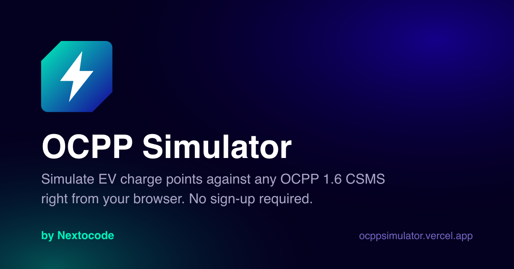

<div align="center">


# OCPP Simulator

**Simulate EV charge points against any OCPP 1.6 CSMS, right from your browser.**
No installation, no account, no sign-in: create the chargers you need and drive them.

[**▶ Try the live demo**](https://ocppsimulator.vercel.app/) ·
[Report a bug](https://github.com/nextocodeoficial/Nextocode_OCPPSimulator/issues) ·
[Nextocode](https://nextocode.com/)




</div>

---

## Contents

1. [What it does](#what-it-does)
2. [Quick start (5 minutes)](#quick-start-5-minutes)
3. [Step-by-step guide](#step-by-step-guide)
4. [Supported OCPP messages](#supported-ocpp-messages)
5. [Languages](#languages)
6. [FAQ and troubleshooting](#faq-and-troubleshooting)
7. [Run it yourself](#run-it-yourself)
8. [Contributing](#contributing)
9. [License](#license)

## What it does

OCPP Simulator plays the **charge point** side of OCPP-J (OCPP over WebSocket). You point it at your **CSMS** (Charge Station Management System) and it behaves like real hardware: it boots, sends heartbeats, reports connector status, authorizes RFID tags, starts and stops transactions, streams meter values, and answers commands sent by the CSMS.

| | |
|---|---|
| ⚡ **Many chargers at once** | Create as many charge points as you need. Each one keeps its own WebSocket session, so several can stay connected and charging in parallel. |
| 🔌 **Multi-connector** | Configure 1 to N connectors per charger, AC or DC, with socket type, power, voltage and current limits. |
| 🔋 **Realistic metering** | Power, energy, voltage, current and battery SoC evolve during a session and are sent as `MeterValues`. |
| 📡 **Network inspector** | Every frame in and out (`CALL`, `CALLRESULT`, `CALLERROR`) with its JSON payload. Pause, copy or clear the log. |
| 🛠️ **Answers CSMS commands** | Remote start/stop, reset, configuration, availability, unlock, trigger message and more. |
| 💾 **Stays in your browser** | Chargers and their settings live in `localStorage`. Nothing is sent anywhere except to the CSMS you configure. |
| 🌍 **Six languages** | English, Español, Italiano, Deutsch, Русский and 中文. |

## Quick start (5 minutes)

You need a CSMS that accepts OCPP 1.6J WebSocket connections (your own backend, [SteVe](https://github.com/steve-community/steve), a commercial platform, etc.) and to know its endpoint URL.

1. Open **<https://ocppsimulator.vercel.app/>**.
2. Click **New charge point**.
3. Enter the **CSMS URL** (e.g. `wss://csms.example.com/ocpp`) and a **Charge point ID** (e.g. `SIM_001`), then press **Create and connect**.
4. The charger connects and sends `BootNotification` on its own. Press **StartTx** to begin a charging session.
5. Watch the messages flow in the **Network traffic** panel and the session in your CSMS.

> [!IMPORTANT]
> Many CSMS only accept charge points that were registered beforehand. If the connection is closed right away or `BootNotification` is rejected, add the **Charge point ID** to your CSMS first. To start transactions, the CSMS must also accept the **idTag** (default `DEMO1234`).

## Step-by-step guide

### 1. Create a charge point

Click **New charge point** (dashboard, or the button at the bottom of the sidebar) and fill in:

| Field | Required | Description |
|---|---|---|
| **Name** | No | Friendly label shown in the sidebar and dashboard, e.g. `Parking lot A`. |
| **CSMS URL** | Yes | WebSocket endpoint of your central system. Must start with `ws://` or `wss://`. |
| **Charge point ID** | Yes | Identity of the charger in your CSMS. The simulator connects to `<CSMS URL>/<Charge point ID>` using the `ocpp1.6` subprotocol. |

The charger is saved in your browser and connects immediately.

> [!TIP]
> The demo runs over HTTPS, so browsers only allow **`wss://`** endpoints from it. To test a CSMS on `ws://localhost`, [run the simulator locally](#run-it-yourself).

### 2. Connect and register

On the charger page the header shows the connection state:

- 🟢 **Connected**: the WebSocket is open.
- 🟡 **Connecting**: handshake in progress.
- ⚪ **Disconnected**: closed or rejected. Use **Connect** to retry.

On every connection the simulator sends `BootNotification` automatically (retrying while the CSMS answers `Pending` or `Rejected`) and then keeps sending `Heartbeat` at the configured `HeartbeatInterval`. You can also send both manually from the controls panel.

### 3. Simulate a charging session

A typical flow from the **OCPP controls** panel:

1. Pick the **connector** you want to use.
2. *(Optional)* **Authorize** to validate the idTag.
3. **StartTx**: authorizes the idTag, starts the transaction and the connector switches to `Charging`.
4. `MeterValues` are sent periodically; follow them in **Charging status**.
5. **StopTx**: closes the transaction with the final meter reading. The connector goes to `Finishing`.
6. **Unlock cable**: the connector goes back to `Available`.

Use **Status** to send any `StatusNotification` (e.g. `Faulted`, `Unavailable`) and test how your CSMS reacts.

### 4. Run several chargers in parallel

Repeat step 1 with different charge point IDs. Each charger has its own WebSocket session and keeps running while you switch between them from the sidebar, so you can simulate a whole site or reproduce concurrency issues in your CSMS. The dashboard shows how many are connected at a glance.

### 5. Inspect the traffic

The **Network traffic** panel lists every OCPP frame with direction, type, action and timestamp. Click a frame to see its JSON payload. Use **Pause**, **Copy** (exports the log as JSON) and **Clear** while debugging.

### 6. Tune the hardware profile

- **Basic config**: name, CSMS URL, charge point ID and protocol.
- **Advanced config**:
  - *Device settings*: device name, model, AC/DC, number of connectors, socket type and cable lock per connector, max power, nominal voltage, max current, RFID reader, display, initial battery SoC and price per kWh.
  - *OCPP configuration*: heartbeat and meter value intervals, sampled measurands, feature profiles, authorization behaviour and other configuration keys reported through `GetConfiguration`.

Changes are saved locally and survive page reloads.

### 7. Delete a charger

Open the charger and press **Delete**. It is disconnected and removed from your browser together with its traffic log.

## Supported OCPP messages

**Charge point → CSMS**

`BootNotification` · `Heartbeat` · `StatusNotification` · `Authorize` · `StartTransaction` · `MeterValues` · `StopTransaction`

**CSMS → charge point** (handled automatically)

`RemoteStartTransaction` · `RemoteStopTransaction` · `Reset` · `ChangeAvailability` · `ChangeConfiguration` · `GetConfiguration` · `UnlockConnector` · `TriggerMessage` · `ClearCache` · `DataTransfer` · `SetChargingProfile` · `ClearChargingProfile` · `GetCompositeSchedule` · `ReserveNow` · `CancelReservation` · `GetLocalListVersion` · `SendLocalList` · `GetDiagnostics` · `UpdateFirmware`

## Languages

The interface is available in **English, Español, Italiano, Deutsch, Русский and 中文**. The language is detected from your browser and can be changed at any time from the language menu in the header. It only changes the interface: open connections keep running and OCPP messages are always sent as defined by the specification.

## FAQ and troubleshooting

<details>
<summary><b>Do I need an account?</b></summary>

No. There is no sign-in and no server-side storage. Everything lives in your browser's `localStorage`, so chargers are per browser and per device. Clearing site data removes them.
</details>

<details>
<summary><b>The charger goes straight back to "Disconnected"</b></summary>

- Check the URL and that it uses `wss://` when the simulator is served over HTTPS.
- Make sure the CSMS accepts the `ocpp1.6` WebSocket subprotocol.
- Many CSMS reject unknown identities: register the charge point ID first.
- Open the **Network traffic** panel and your browser's developer console to see the close reason.
</details>

<details>
<summary><b>StartTx is rejected</b></summary>

The CSMS answered `Authorize`/`StartTransaction` with an idTag status other than `Accepted`. Register the idTag (default `DEMO1234`) as an RFID card in your CSMS, or change the idTag on the connector.
</details>

<details>
<summary><b>Is my data sent to Nextocode?</b></summary>

No. The only network traffic generated by the simulator is the WebSocket connection to the CSMS you configure (plus anonymous page analytics on the public demo).
</details>

## Run it yourself

### Requirements

- Node.js 20+
- Yarn 1.x

### Local development

```bash
git clone https://github.com/nextocodeoficial/Nextocode_OCPPSimulator.git
cd Nextocode_OCPPSimulator
yarn install
yarn dev
```

Open the URL printed in the terminal (usually <http://localhost:5173>).

### Configuration (optional)

Copy `.env copy.example` to `.env` and adjust:

| Variable | Default | Description |
|---|---|---|
| `VITE_DEFAULT_CSMS_URL` | *(empty)* | CSMS URL pre-filled in the **New charge point** form. Users can still change it. |
| `VITE_BASE_URL` | `/` | Sub-path when hosting under a folder (e.g. GitHub Pages). |

### Docker

```bash
docker compose up --build
# → http://localhost:3000
```

Pass build arguments to customise it, e.g. `VITE_DEFAULT_CSMS_URL=wss://csms.example.com/ocpp docker compose up --build`.

### Deploy to Vercel

Import the repository in Vercel with the **Vite** preset (build command `yarn build`, output directory `dist`). The app uses hash routing, so no rewrite rules are needed.

### Scripts

| Command | Description |
|---|---|
| `yarn dev` | Start the development server |
| `yarn build` | Type-check and build for production |
| `yarn preview` | Preview the production build |
| `yarn test` | Run the test suite (Vitest) |
| `yarn lint` | Lint the project (ESLint) |

### Tech stack

React 19 · TypeScript · Vite · Redux Toolkit · TanStack Query · Tailwind CSS 4 · Radix UI · i18next · Vitest

## Contributing

Issues and pull requests are welcome.

1. Fork the repository and create a branch: `git checkout -b feat/my-feature`.
2. Keep `yarn test`, `yarn lint` and `yarn build` green.
3. When you add UI text, add the key to **all six** files in `src/i18n/locales/` (a test checks that they stay in sync).
4. Use [Conventional Commits](https://www.conventionalcommits.org/) and open a pull request.

## License

Released under the [MIT License](./LICENSE).

---

<div align="center">
<sub>© 2026 <a href="https://nextocode.com/">Nextocode</a>. All rights reserved.</sub>
</div>
